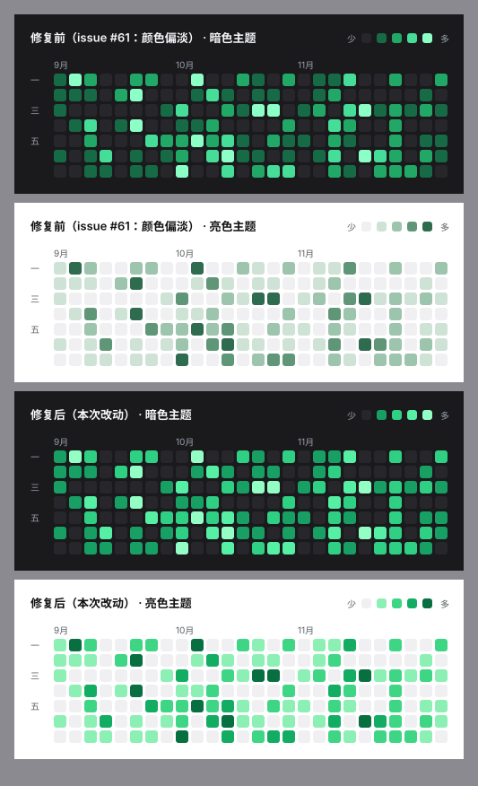

# 刷题热力图配色：从「一片灰绿」换到荧光绿阶梯

Issue [#61](https://github.com/ZF3373/icpc-workbench/issues/61) 的反馈原话是
「可以调亮一点，或者换亮一点的颜色，e.g cf 的荧光绿那样」。问题出在上一版
（8ca9475「数据概览重构为极简现代扁平化」）的亮色配色——当时为了"融入白底"，
把饱和度压到了 8~56%，四档挤成一片灰绿，读起来发灰而不是发绿。

## 改了什么

| | 修复前 | 修复后 |
| --- | --- | --- |
| 亮色四档 | `#cfe2d6` `#9dc4ad` `#5f9678` `#2f6b4f` | `#8cefb4` `#3ed684` `#12ad62` `#086f40` |
| 亮色饱和度 | 8% → 56% | 41% → 93% |
| 暗色四档 | `#166b46` `#22a866` `#45dd97` `#8bffc6` | `#179f64` `#2fd084` `#55f0a4` `#93ffc5` |
| 暗色平均相对亮度 | 0.44 | 0.56 |

两个主题都往"荧光绿"方向走，但**不是简单调亮**——调亮会让四档糊成一片，
所以同时重排了明度阶梯：

- **亮色**：白卡上越练越深。四档亮度 0.71 / 0.51 / 0.31 / 0.12 近似等距，
  相邻档对比度 1.22 / 1.36 / 1.55 / 2.14（都 ≥ 1.18）；最浅档对空格 \#f0f0f2
  是 1.22，"今天没练"和"练了一道"分得开。最浅档饱和度从旧的 0.08 提到 0.41，
  不再是灰的。
- **暗色**：深底上越练越亮。最浅档从 \#166b46 提到 \#179f64——旧的这一档相对亮度
  只有 0.11、对空格 \#26262b 的对比度 2.31，几乎糊进背景；现在 0.26 / 4.43。
  最亮档对卡片底 14.4:1。

## 为什么把配色搬进独立模块

原来四档色是 `ActivityHeatmap.tsx` 里的一个字面量常量，改一次只能靠截图肉眼看
"是不是又淡了"。issue #61 恰恰是这种退化第二次发生（第一次是 8ca9475 把亮色
调成低饱和）。现在拆成 `client/src/heatmapColors.ts`，把可计算的性质做成断言：

`client/test/heatmapColors.test.ts` 锁住六条：

1. 四档 + 空格互不相同；
2. **对卡片底的对比度严格递增**——注意方向在两套主题里相反（亮色越练越深、
   暗色越练越亮），所以统一的不变量是"对比度递增"而不是"亮度递增"，那才是
   眼睛看到的"一格比一格重"；
3. 相邻档对比度 ≥ 下限（亮 1.18 / 暗 1.2，实测分别为 1.22 / 1.37）；
4. 首档与空格色分得开（"没练"不等于"练了一点"，亮 ≥ 1.18 / 暗 ≥ 4.0，
   实测 1.22 / 4.43）；
5. 空格色对卡片底可见（否则格子像掉了一块）；
6. 平均亮度不低于下线、亮色饱和度逐档递增且首档 ≥ 0.35。

拿旧配色回测这组断言：亮色首档饱和度 0.08（要求 ≥ 0.35）、暗色平均亮度 0.44
（要求 ≥ 0.50）、暗色首档对空格 2.31（要求 ≥ 4.0）——三条会红。也就是说这次
的退化如果再次发生，CI 会拦下来，而不是等下一轮反馈。

## 顺带清理

- 删掉 `index.css` 里的 `--heatmap-empty`：组件早已改成字面量取色，这个 CSS 变量
  成了没人读的副本，留着只会和实际用色漂移（现在空格色也在 `heatmapColors.ts`）。
- `--heatmap-empty` 不在 `tokens.ts` 的配对表里，因此 `check:tokens` 不受影响
  （仍 16 组全绿）。

## 验证

- `client` 全量测试 669 项通过（新增 13 项配色测试）；
- `tsc --noEmit`、`oxlint` 0 error（1 条既有的 `NoteEditor.tsx` hook 依赖 warning，
  非本次改动）；
- `check:tokens` 16 组一致、`check:contrast` 全部达标。

## 文件

- `client/src/heatmapColors.ts`（新增）——两套调色板 + WCAG 亮度/对比度工具
- `client/test/heatmapColors.test.ts`（新增）——把上面六条性质做成断言
- `client/src/components/ActivityHeatmap.tsx`——改用 `heatmapPalette()`，删掉内联常量
- `client/src/index.css`——移除已无人读取的 `--heatmap-empty`
